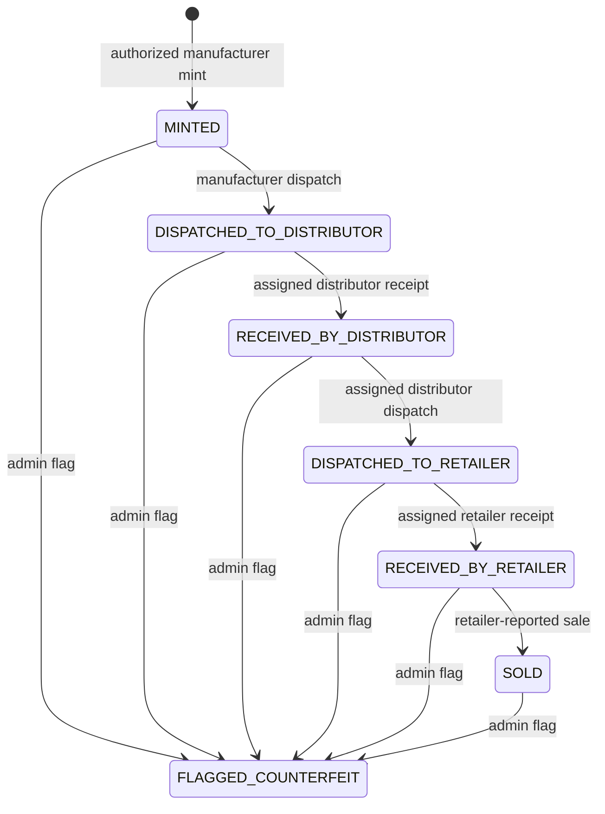

# ProductRegistry V2

## Status

V2 is implemented and tested on the local in-memory Hardhat network. It has **not** been deployed. The backend continues to read legacy V1 products using `CONTRACT_ADDRESS`; new registration and supply-chain actions require `PRODUCT_REGISTRY_V2_ADDRESS` to be configured after an separately approved Sepolia deployment. The last read-only check of the configured backend registry identified the V1 deployment at `0xa3d897002aAFec974D1AF13039756CaC19c41ECD` on chain `11155111`; no deployment or transaction was performed for V2 here.

V1 and V2 are separate contracts. There is no proxy or storage upgrade. Existing products, including FPD0024 and FPD0025, remain on V1 and are not copied or re-minted. V2 product rows save their registry version, address, and chain ID at confirmation. A historical row without registry identity is ambiguous unless a matching saved registration proves the original prepared destination and chain; the application should report it as unresolved rather than assume the current V1 configuration. V1 custody history is not indexed by the backend, so the admin API labels it as unavailable rather than reconstructing events.

## Lifecycle



`SOLD` means the assigned retailer submitted an explicit sale attestation. It is not proof of payment or consumer identity. QR scans call read-only verification; they cannot advance lifecycle state. Flagging is an explicit admin contract action and is never triggered automatically by AI scoring.

The contract emits `ProductMinted`, `CustodyAssigned`, and one `ProductLifecycleEvent` for each transition. The lifecycle event includes actor, counterparty, previous and new state, custodian, and timestamp. The product ID is an indexed string; its event topic is a hash and is validated by matching the expected product ID hash.

## Roles and authorization

| Action | Required contract role | Additional contract restriction |
| --- | --- | --- |
| Mint | Manufacturer | Caller must be manufacturer; assigned distributor and retailer must have their respective roles and be distinct nonzero addresses |
| Dispatch to distributor | Manufacturer | Must be the product manufacturer and current custodian; state must be `MINTED` |
| Receive from manufacturer | Distributor | Must be the assigned distributor; state must be `DISPATCHED_TO_DISTRIBUTOR` |
| Dispatch to retailer | Distributor | Must be assigned distributor and current custodian; state must be `RECEIVED_BY_DISTRIBUTOR` |
| Receive from distributor | Retailer | Must be assigned retailer; state must be `DISPATCHED_TO_RETAILER` |
| Record sale | Retailer | Must be assigned retailer and current custodian; state must be `RECEIVED_BY_RETAILER` |
| Flag counterfeit | Contract admin | Product must exist and must not already be flagged |

V2 preserves self-request plus admin approval for role assignment. A public caller can request only its own role; only the constructor-set contract admin can approve or revoke. Database approval and wallet binding do not create an on-chain role. Each account must have an approved database profile, an active user, a signed wallet binding, and the correct V2 contract role. The contract admin must separately approve the manufacturer, distributor, and retailer wallets on V2 after deployment. Do not copy V1 role state into V2 automatically.

### Safe role-request and approval procedure

There is intentionally no backend endpoint that grants an on-chain role, and the dashboard does not impersonate the contract admin. After deployment and verified website wallet binding:

1. The participant connects the bound wallet on Sepolia and submits `requestRole(role, companyName)` to the V2 contract from that same wallet. Enum values are `MANUFACTURER = 1`, `DISTRIBUTOR = 2`, and `RETAILER = 3`. This transaction creates a request only; it does not authorize the account.
2. The contract admin independently checks the website account/profile approval and the requester's wallet, then calls `approveRole(requesterWallet)` from the immutable `admin` account. Do not approve a wallet based only on a client-supplied address or screenshot.
3. Read `getRole(requesterWallet)` from the deployed V2 contract and confirm the expected numeric role before enabling that account's product workflow. Also verify the profile remains active, approved, and wallet-bound in the website database.

No role request or approval was submitted as part of implementation. This procedure requires an authorized wallet and explicit transaction approval after deployment.

### Contract-admin custody decision

The current V2 contract sets `admin` to the deployment caller and makes it immutable. That account can approve/revoke roles and flag products; losing or compromising it has no on-chain recovery path. Keeping a single EOA avoids extra contract complexity but leaves one key as the control point. A multisig admin would reduce single-key risk but requires a new deployment design and changes the authorization assumptions/tests. No admin transfer or multisig change has been made; choose the model before deployment.

## Backend integration

New registration preparation encodes `ProductRegistryV2.mintProduct` only after resolving the authenticated manufacturer and selected partner profiles server-side, checking verified wallet bindings and V2 roles, saving the reference image and hashes, and persisting pending registration data. Confirmation validates the same transaction, sender, chain, registry, event, product topic, on-chain product, partner wallets, and saved image before MongoDB completion.

Authenticated lifecycle API:

| Method and path | Access | Purpose |
| --- | --- | --- |
| `GET /api/products/lifecycle?page=1&pageSize=20` | Manufacturer, distributor, retailer | Return the caller's assigned products, live chain state where available, and their pending confirmation operations |
| `POST /api/products/:productCode/lifecycle/prepare` | Manufacturer, distributor, retailer | Body `{ "action": "DISPATCH_TO_DISTRIBUTOR" }`; derives actor and allowed action from the authenticated account and product assignment, saves the prepared call, and returns exact transaction data |
| `POST /api/products/lifecycle/operations/:operationId/claim` | Manufacturer, distributor, retailer | Body `{ "submissionAttemptId": "…" }`; atomically reserves the prepared operation for one browser attempt before MetaMask submission |
| `POST /api/products/lifecycle/operations/:operationId/release` | Manufacturer, distributor, retailer | Body `{ "submissionAttemptId": "…" }`; releases only that attempt when the wallet definitively rejected before a transaction hash exists |
| `POST /api/products/lifecycle/operations/:operationId/confirm` | Manufacturer, distributor, retailer | Body `{ "transactionHash": "0x…", "submissionAttemptId": "…" }`; pins one hash to the operation and verifies sender, chain, destination, calldata, receipt event, and resulting contract state before storing a confirmed lifecycle event idempotently |
| `GET /api/admin/products/:productCode/lifecycle?page=1&pageSize=20` | Admin only | Returns current registry/chain status, verified backend-indexed V2 transitions, and paginated stored verification/AI assessment records |

The browser submits transactions through the authenticated user's MetaMask wallet. The backend never signs or submits transactions. A failed MongoDB confirmation can be retried with the same operation and transaction hash; it cannot ask for another operation once a transaction hash is durably claimed. Consumer QR verification uses a read-only registry read and remains separate from custody state and AI scan-risk assessment.

Lifecycle operations use `PREPARED`, `SUBMITTING`, `CONFIRMED`, `FAILED`, and `REVIEW_REQUIRED` states. V2 browser clients atomically claim an operation before opening MetaMask, so a competing browser cannot submit a second transaction for that operation. The first submitted hash is durably pinned; retries must reuse it. A wallet rejection can release only a no-hash claim. A reverted receipt for a claimed V2 attempt becomes a durable `FAILED` record and releases the preparation lock; starting another transaction requires a deliberate user action. Temporary RPC or database confirmation failures retain the same operation ID and transaction hash for retry. Definitive evidence mismatches become `REVIEW_REQUIRED`, retain the product lock, and are never shown as confirmed. A claimed operation is not expired or replaced while it may have been submitted. An expired V2 preparation can be replaced only when it was never claimed and has no hash. For legacy/unclaimed operations, a reverted receipt stays `REVIEW_REQUIRED` with the product lock retained; an already-submitted competing hash can then be checked against the same operation. Observed hashes remain attached to that operation, and only a transaction with a matching event and verified resulting chain state can complete it. Legacy preparations remain addressable for manual reconciliation. Confirmation validates the transaction-specific event and replays later lifecycle events in the same block before comparing the block-end contract state, so a valid next transition in that block does not invalidate the earlier receipt.

## Configuration and local checks

From a fresh checkout, install the locked dependencies in each project folder, then compile the contract locally before starting the backend. Backend registry services load the generated Hardhat artifact; `blockchain/artifacts` is generated output and is not committed:

   ```powershell
   cd E:\SodeA\Anti-Counterfeit\blockchain
   npm ci
   npm run compile
   ```

The compile command only builds local Solidity artifacts; it does not connect to a network or deploy a contract. `npm test` runs Hardhat's local in-memory tests.

### Clean-checkout deliverable checklist

The current working tree contains several V2 inputs as untracked or modified files. A clean checkout can compile and test V2 only after the deliverable includes:

- `blockchain/contracts/ProductRegistryV2.sol` — V2 source.
- `blockchain/test/ProductRegistryV2.test.js` — local contract tests.
- `blockchain/hardhat.config.js` — compiler and network configuration.
- `blockchain/package.json` and the matching `blockchain/package-lock.json` — compile/test scripts and locked toolchain.
- `blockchain/scripts/deployProductRegistryV2.js` — required only for a separately approved deployment; it is not needed to compile or test.
- `backend/services/blockchainV2Service.js` and its lifecycle integration files — required for the backend to consume the generated ABI.

The root `.gitignore` excludes `blockchain/artifacts/` and `blockchain/cache/`. Do not add generated artifacts as a substitute for the Solidity source; run `npm run compile` after including the source. The V2 source, V2 test, deployment script, backend V2 service and lifecycle integration are currently untracked in this working tree, while the Hardhat config and package manifest are modified. No files have been staged or committed by this task.

After a separately reviewed Sepolia deployment, set `PRODUCT_REGISTRY_V2_ADDRESS=<deployed V2 address>` in the backend runtime configuration. Keep `CHAIN_ID=11155111` and the backend's existing Sepolia RPC configuration. Do not replace `CONTRACT_ADDRESS`; it remains the V1 registry for historical products.

Run local contract and application tests without selecting a public network:

   ```powershell
   npm test
   cd ..\backend; npm ci; npm test
   cd ..\frontend; npm ci; npm test; npm run build
   ```

The V2 local suite uses Hardhat's in-memory network. It does not deploy to Sepolia. Tests that mock RPC/application services are not live chain or database verification.

## Frontend workflows

- Manufacturer: register and mint a new V2 product, then dispatch it to its saved distributor assignment.
- Distributor: view assigned records, confirm receipt, then dispatch to the product's saved retailer assignment.
- Retailer: confirm receipt, then explicitly record a retailer-reported sale.
- Consumer: scan and verify the QR through the existing read-only endpoint. Scanning never sets `SOLD`.
- Admin: Product Monitoring can open paginated lifecycle and verification details. The UI separates current chain state, confirmed custody events, saved authenticity outcomes, and AI scoring states.

Actions remain unavailable when the backend cannot read the configured V2 contract or when the authenticated wallet, profile, role, assignment, or chain state does not match. No demo products or substitute status values are provided.

## Known limitations

- V2 has no live Sepolia address until deployment approval. Consequently this implementation cannot demonstrate live V2 lifecycle operations yet.
- Existing V1 products remain readable, but the backend did not persist old V1 state-transition logs; admin history for them is explicitly not indexed.
- IPFS is not integrated. The current product reference image remains local; its SHA-256 is persisted and checked. The legacy `ipfsImageHash` field is empty for this application flow.
- AI risk scoring remains an assessment signal, not a custody transition or automatic counterfeit decision.
- Full end-to-end MetaMask interaction, role approval, and RPC confirmation require a configured V2 deployment and authorized Sepolia wallets. No keys or balances should be shared with the application.
- The admin dashboard currently has no V2 role-request inbox or approval UI; use the reviewed contract interaction procedure above until that feature is separately designed.
- For the one-time website admin bootstrap, see `../backend/ADMIN_PROVISIONING.md`. Never put the bootstrap password or a deployer key in source control or log output.
- A private-key-shaped value was removed from the current integration guide, but it remains in repository history. Rotate it if it was genuine. No history rewrite is performed by this project task; decide separately whether history cleanup is warranted after rotation.

## Separate deployment checklist — requires owner approval

1. Review the exact V2 source, compiled artifact, compiler version, and local Hardhat results.
2. Confirm the deployment signer and Sepolia account through the owner's wallet; do not provide its private key to this project or Codex.
3. Obtain explicit approval before running `deployProductRegistryV2.js` against the `sepolia` network. The script refuses other network names and chain IDs.
4. Independently verify deployment receipt, chain ID, bytecode, constructor admin, and address on a trusted explorer/RPC.
5. Configure `PRODUCT_REGISTRY_V2_ADDRESS` without changing the V1 `CONTRACT_ADDRESS`; restart backend and verify its read-only health/contract checks.
6. Each participant requests its own V2 role; the V2 contract admin reviews and approves role requests. Verify each role with read-only `getRole` before using manufacturer partner selection.
7. Run a controlled demo only with new test products, authorized participants, informed transaction signers, and no changes to FPD0024/FPD0025.
8. Verify a full custody cycle, QR read-only behavior, saved lifecycle events, and admin views from actual receipts and state.
